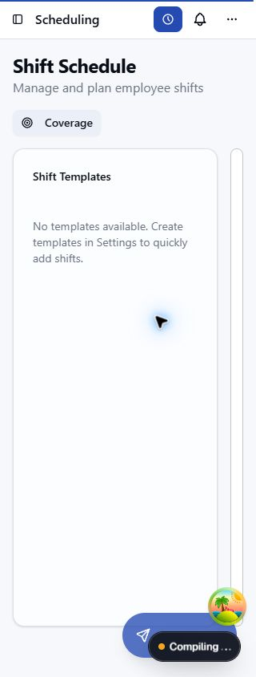
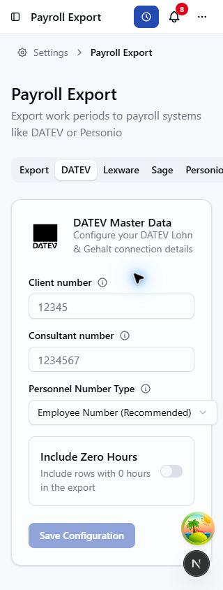

# Z8 mobile view audit

Date: 16 October 2026. Browser: connected Chrome. Main viewport: 390 × 844 CSS pixels; targeted checks at 320 × 844.

**13 primary findings and 15 additional table-based views need mobile work.** Scheduling is the strongest blocker: its fixed template sidebar leaves almost no usable calendar. Payroll Export clips whole tabs; template editors, absence settings and several detail headers also clip controls.

The inventory accounts for all **161 route patterns** (142 static, 19 dynamic). This is an available-state browser audit, not full coverage of every role, data state, locale or interaction. Gated routes and missing fixtures are explicitly listed below; they are not passes.

Implementation status and post-fix Chrome evidence: [Mobile fixes](./2026-10-16-mobile-fixes.md). The findings below preserve the original observations.

## Primary findings

| ID | Priority | Routes / view | Observed problem | Evidence | Suggested direction |
| --- | --- | --- | --- | --- | --- |
| M01 | Medium | `/settings/employees` | Employee directory retains eight desktop columns; row actions require extensive horizontal scrolling. | 1041 px table in a 306 px scroller; 16 employees at 390 px. | Use employee cards or keep name and actions visible. |
| M02 | Medium | `/time-tracking` | History retains desktop rows; endpoints, duration and description cannot be read together. | 639 px table in a 296 px scroller; 10 rows at 390 px. | Stack work-period rows on phones. |
| M03 | High | `/scheduling` | Fixed template sidebar collapses the actual shift calendar. | 256 px sidebar leaves 84 px for calendar at 390 px and about 14 px at 320 px. | Move templates above the calendar or into a drawer on phones. |
| M04 | Medium | `/analytics`, `/analytics/work-hours`, `/analytics/vacation-trends`, `/analytics/team-performance`, `/analytics/overtime-burn-down` | Charts extend outside cards into the page scroller; right-hand plots and labels start off-screen. Detail tables also retain desktop widths. | Overview content reaches 599 px inside 380 px; other populated analytics reach 574–610 px. Detail tables measure 517–627 px in 298 px scrollers. | Allow chart grid items to shrink and size charts to their containers; provide compact detail rows. |
| M05 | High | `/settings/payroll-export` | Provider tabs are clipped and have no scrolling container; later providers, mappings and history cannot be reached visually. | 691 px tab row inside 358 px at 390 px; later tabs extend to x=704. At 320 px, Personio and subsequent tabs are clipped. | Use the existing scrollable settings tab pattern or a mobile selector. |
| M06 | Medium | `/settings/email-templates`, `/settings/enterprise/email?tab=templates`, `/platform-admin/system-email-templates` | Template navigation expands beyond the mobile page; the right side of the list and editor is clipped. | Organization template content reaches 684 px inside 380 px; template buttons are 634 px wide. System template grid reaches 668 px inside 332 px. | Make grid items shrinkable and use a stacked template selector/editor. |
| M07 | Medium | `/settings/vacation`, `/settings/holidays` | Vacation policy content expands past the clipped page edge, including search and actions. The Holidays subpage also clips the Categories tab. | Policy area reaches 764 px inside 348 px; search input is 384 px and refresh action starts at x=587. Holiday tabs reach 432 px inside 348 px, with Categories at x=359–445. | Contain the policy table and make its toolbar wrap or stack. |
| M08 | Medium | `/notifications` | Header actions are clipped; narrow notification bodies also wrap into very short lines. | Header scroll width 364 px inside 346 px at 390 px and 276 px at 320 px. Settings runs from x=286 to x=381 at 320 px. | Stack header actions below the title; reduce fixed-width columns in notification rows. |
| M09 | Medium | `/calendar (Week mode)` | Week grid clips the final day; horizontal scrolling does not reveal Sunday. | Settled populated grid is 404 px inside a 346 px overflow-hidden container. Sunday starts at x≈381 and ends at x≈421 at 390 px. | Fit all seven day columns or provide explicit horizontal scrolling/a mobile agenda. |
| M10 | Low | `/settings/import`, `/settings/clockodo-import` | Seven-step import progress indicator is wider than the phone content area. | 512 px stepper inside 342 px; steps 6 and 7 are clipped at 390 px. Credential form itself fits. | Use a compact current-step indicator on phones. |
| M11 | Medium | `/platform-admin/settings` | Global settings cards and form controls extend beyond the mobile content width. | 392 px content inside 332 px; input and textarea right edges reach x=391 at a 390 px viewport. | Make form/card grid items shrink and wrap long content. |
| M12 | Low | `/settings/payroll-readiness` | Lower readiness cards extend beyond the page edge. | 395 px card grid inside 348 px; the right card borders are clipped at 390 px. | Constrain card minimum widths and wrap labels/links. |
| M13 | Medium | `/settings/locations/[locationId]` | Location detail title and actions remain in one row; Delete is off-screen. | Populated Downtown Branch header reaches 473 px inside 380 px; Delete occupies x=376–473. | Stack actions below the location title on phones. |

## Additional views retaining desktop tables

These tables are contained by horizontal scrollers. They do not widen the whole document. The mobile usability problem is that common row information and actions sit far from the identity column. Prioritize action-heavy operational tables over reference tables.

| ID | Priority | Route | Table / visible width at 390 px | Information or actions off the initial screen |
| --- | --- | --- | --- | --- |
| T01 | Medium | `/team/absences` | 1043 / 346 px | Allowance, balance and Record absence action |
| T02 | Medium | `/team/driving` | 579 / 346 px | Missing details and employee calendar action |
| T03 | Medium | `/approvals` | 937 / 306 px | Approve and Reject actions |
| T04 | Medium | `/reports/projects` | 786 / 296 px | Project member counts and View project details action |
| T05 | Medium | `/settings/audit-export` | 776 / 298 px | User/entity context and details action |
| T06 | Medium | `/settings/change-policies` | 856 / 356 px | Policy windows, notification setting and Actions |
| T07 | Medium | `/settings/work-policies` | 502 / 356 px | Work limits, break rules and menu |
| T08 | Medium | `/settings/locations` | 563 / 356 px | Subareas, supervisors and status |
| T09 | Medium | `/settings/work-categories` | 516 / 298 px | Category-set usage and edit/delete actions |
| T10 | Medium | `/settings/projects` | 1061 / 308 px | Budget, team member and task controls |
| T11 | Medium | `/settings/vacation/employees` | 1265 / 296 px | Allowance values and Edit action |
| T12 | Medium | `/platform-admin/organizations` | 616 / 340 px | Status, created date and organization actions |
| T13 | Medium | `/platform-admin/users` | 793 / 330 px | Roles, status, sessions and user actions |
| T14 | Medium | `/platform-admin/worker-queue` | 1314 / 250 px | Cron schedule, next run and editing/reset actions |
| T15 | Low | `/licenses` | 551 / 294 px | License metadata and repository/homepage links |

`/settings/audit-log` and `/settings/enterprise/audit-log` redirect to the Audit Activity view in T05. These are shared-view aliases, not separate implementations.

The vehicle report’s annual month matrix and Calendar Month grid also scroll horizontally, but preserve a meaningful two-dimensional layout. They are recorded as coverage rather than automatic defects.

## Evidence

### Scheduling at 320 px

### Payroll Export at 320 px

Additional captures: [Email templates](./images/mobile-2026-10-16/email-templates-390.png) · [Absence policies](./images/mobile-2026-10-16/vacation-settings-390.png) · [Notifications at 320 px](./images/mobile-2026-10-16/notifications-320.png) · [Calendar Week](./images/mobile-2026-10-16/calendar-week-390.png) · [Analytics charts](./images/mobile-2026-10-16/analytics-charts-390.png) · [Team absence table](./images/mobile-2026-10-16/team-absences-table-390.png) · [Import progress](./images/mobile-2026-10-16/import-stepper-390.png) · [Platform settings](./images/mobile-2026-10-16/platform-settings-390.png) · [Payroll Readiness](./images/mobile-2026-10-16/payroll-readiness-390.png) · [Employee directory](./images/mobile-2026-10-16/employees-390.png).

## Other runtime findings

- **D01 — Analytics navigation:** all five tabs rendered with empty text and no accessible label. The browser also logged a Base UI tab/button compatibility warning. The same five empty tabs were verified after restoring the desktop viewport to 2291 px. This is a shared functional/accessibility finding, not a mobile-specific defect. Investigate the shared tab/link composition separately.
- **D02 — Work Diagnostics:** `/settings/work-diagnostics` fails with a database-query error, so the normal screen could not be audited. Its error block also needs mobile wrapping.
- A transient `signal timed out` application banner appeared on some pages. Cold compilation and asynchronous loading caused several captures to contain only a shell; those captures were revisited where possible and are not counted as full view coverage.

## Scope and limits

- Signed-in organization owner/platform administrator in Umami TestGmbH. Demo employees, work periods, projects, teams, shifts, vehicles and notifications were available; travel expense claims/reports were not.
- Inspection used page screenshots, rendered DOM/accessible controls, bounding boxes and scroll-container measurements. Some transient first-load and animation captures were excluded from defect decisions.
- No organization records, integrations, feature switches, approvals, credentials or onboarding state were intentionally changed. Report-generation buttons were used only to read report data. New expense drafts were not created because the UI says they autosave.
- Main viewport pass used English and the current theme/font settings. This is desktop Chrome with a CSS viewport override, not real-device touch/keyboard testing. Targeted 320 px checks covered Scheduling, Payroll Export and Notifications.
- Personnel Files and Billable Time were disabled; payroll access was restricted; billing was disabled in the deployment. Authentication forms need an anonymous session and valid reset/verification contexts.
- Onboarding Welcome/Complete and session initialization were not opened because source shows automatic state-changing effects. First-install setup needs a disposable unconfigured instance.
- Route patterns with tokens or unavailable records remain unreviewed. Representative drawers reviewed: approval details, team membership, absence entry and calendar filters. Other modal/form states are outside this pass.
- Running source was **`X:/Projects/umami/z8`**. This report is saved in **`Y:/Codex/Worktrees/faa6/z8`**; source references below describe the running checkout and may differ from the report branch.
- Temporary viewport overrides were reset after browser review.

## Source pointers

| Finding | Running source location |
| --- | --- |
| M01 | `apps/webapp/src/app/[locale]/(app)/settings/employees/employees-page-client.tsx:446` |
| M02 | `apps/webapp/src/components/time-tracking/time-entries-table.tsx:141` |
| M03 | `apps/webapp/src/components/scheduling/scheduler/shift-scheduler.tsx:283` |
| M03 | `apps/webapp/src/components/scheduling/scheduler/template-sidebar.tsx:117` |
| M05 | `apps/webapp/src/app/[locale]/(app)/settings/payroll-export/page.tsx:148` |
| M06 | `apps/webapp/src/components/settings/email-templates/email-template-settings-client.tsx:299` |
| M06 | `apps/webapp/src/components/platform-admin/system-email-templates/system-email-template-settings-client.tsx:252` |
| M07 | `apps/webapp/src/components/settings/vacation/vacation-policies-table.tsx:335` |
| M08 | `apps/webapp/src/components/notifications/notifications-inbox.tsx:369` |
| D01 | `apps/webapp/src/app/[locale]/(app)/analytics/layout.tsx:124` |

These are investigation starting points, not implemented fixes. Review criteria followed the [Web Interface Guidelines](https://github.com/vercel-labs/web-interface-guidelines/blob/main/command.md).

## Route coverage

Locale prefix `/en` is omitted. “Rendered state inspected” applies only to the state visible in this pass. No unreviewed or blocked route should be treated as mobile-ready.

| Route pattern | Browser coverage / limit |
| --- | --- |
| `/` | Reviewed populated dashboard via signed-in authentication redirects; no confirmed layout issue. |
| `/absences` | Rendered state inspected at 390 px; no additional layout issue confirmed. Deeper interactions not exercised. |
| `/accept-invitation/[invitationId]` | Not reviewed: no real record/link or valid token available in the current UI. |
| `/analytics` | Reviewed populated overview. M04; blank navigation tabs also observed (D01). |
| `/analytics/overtime-burn-down` | Reviewed chart/table state after loading earlier in the pass. M04 and D01. |
| `/analytics/team-performance` | Reviewed populated charts and team detail table. M04 and D01. |
| `/analytics/vacation-trends` | Reviewed populated charts and employee balances. M04 and D01. |
| `/analytics/work-hours` | Reviewed populated charts and 16 employee rows earlier in the pass; repeat navigation remained loading. M04 and D01. |
| `/approvals` | Rendered state inspected at 390 px; no additional layout issue confirmed. Deeper interactions not exercised. T03. |
| `/approvals/deputy-decisions/[absenceId]` | Not reviewed: deputy-decision assignment context required. |
| `/approvals/inbox` | Reviewed 10-request mobile cards and time-correction detail drawer; no confirmed layout issue. |
| `/approvals/review/[organizationId]/[kind]/[id]` | Direct review route not opened; inbox detail drawer reviewed. Valid route link/context required. |
| `/billing/suspended` | Rendered state inspected at 390 px; no additional layout issue confirmed. Deeper interactions not exercised. |
| `/calendar` | Reviewed Day, Week, Month, Year and Filters & Legend drawer. M09 in Week; Month uses intentional contained scrolling. |
| `/calendar/[employeeId]` | Reviewed populated Sterling Waters Day calendar via a real Driving Details link; no Day-mode layout issue. Personal calendar Week issue M09 is separately verified. |
| `/compliance` | Rendered state inspected at 390 px; no additional layout issue confirmed. Deeper interactions not exercised. |
| `/forgot-password` | Signed-in account redirects to Dashboard; anonymous recovery form not reviewed. |
| `/init` | Not opened: initializes/activates session organization automatically; needs dedicated session test. |
| `/join/[code]` | Not reviewed: no real record/link or valid token available in the current UI. |
| `/kiosk` | Reviewed unpaired kiosk code-entry screen; paired clocking state requires a test kiosk. |
| `/licenses` | Rendered state inspected at 380 px; no additional layout issue confirmed. Deeper interactions not exercised. T15. |
| `/my-documents` | Personnel Files feature disabled. Visited list/settings paths returned 404; actual workspace/detail states not reviewed. |
| `/my-requests` | Rendered state inspected at 390 px; no additional layout issue confirmed. Deeper interactions not exercised. |
| `/notifications` | Reviewed 8-unread populated inbox at 390 and 320 px. M08. |
| `/onboarding/complete` | Not opened: source completes onboarding automatically on mount; needs disposable account. |
| `/onboarding/notifications` | Rendered state inspected at 380 px; no additional layout issue confirmed. Deeper interactions not exercised. |
| `/onboarding/organization` | Existing-organization context redirects to Profile; organization creation state not reviewed. |
| `/onboarding/profile` | Rendered state inspected at 380 px; no additional layout issue confirmed. Deeper interactions not exercised. |
| `/onboarding/vacation-policy` | Rendered state inspected at 380 px; no additional layout issue confirmed. Deeper interactions not exercised. |
| `/onboarding/welcome` | Not opened: source starts onboarding automatically on mount; needs disposable account. |
| `/onboarding/wellness` | Rendered state inspected at 380 px; no additional layout issue confirmed. Deeper interactions not exercised. |
| `/onboarding/work-schedule` | Rendered state inspected at 380 px; no additional layout issue confirmed. Deeper interactions not exercised. |
| `/onboarding/work-templates` | Rendered state inspected at 380 px; no additional layout issue confirmed. Deeper interactions not exercised. |
| `/organization` | Rendered state inspected at 390 px; no additional layout issue confirmed. Deeper interactions not exercised. |
| `/payroll` | Access-denied state reviewed; payroll officer access required for actual workspace. |
| `/payroll/work-balances` | Returned 404; workspace unavailable in current access/configuration. |
| `/payroll/work-balances/[employeeId]` | Not reviewed: no real record/link or valid token available in the current UI. |
| `/personnel-files` | Personnel Files feature disabled. Visited list/settings paths returned 404; actual workspace/detail states not reviewed. |
| `/personnel-files/[employeeId]` | Personnel Files feature disabled. Visited list/settings paths returned 404; actual workspace/detail states not reviewed. |
| `/personnel-files/due-for-deletion` | Personnel Files feature disabled. Visited list/settings paths returned 404; actual workspace/detail states not reviewed. |
| `/personnel-files/payslip-batches` | Personnel Files feature disabled. Visited list/settings paths returned 404; actual workspace/detail states not reviewed. |
| `/personnel-files/payslip-batches/[batchId]` | Personnel Files feature disabled. Visited list/settings paths returned 404; actual workspace/detail states not reviewed. |
| `/personnel-files/sick-leave` | Personnel Files feature disabled. Visited list/settings paths returned 404; actual workspace/detail states not reviewed. |
| `/platform-admin` | Overview populated state reviewed via billing-disabled redirect; no confirmed layout issue. |
| `/platform-admin/analytics` | Rendered state inspected at 380 px; no additional layout issue confirmed. Deeper interactions not exercised. |
| `/platform-admin/billing` | Redirects to platform overview because billing is disabled; billing workspace not reviewed. |
| `/platform-admin/diagnostics` | Rendered state inspected at 380 px; no additional layout issue confirmed. Deeper interactions not exercised. |
| `/platform-admin/organizations` | Rendered state inspected at 390 px; no additional layout issue confirmed. Deeper interactions not exercised. T12. |
| `/platform-admin/settings` | Rendered state inspected at 380 px; no additional layout issue confirmed. Deeper interactions not exercised. M11. |
| `/platform-admin/system-email-templates` | Rendered state inspected at 380 px; no additional layout issue confirmed. Deeper interactions not exercised. M06. |
| `/platform-admin/users` | Rendered state inspected at 380 px; no additional layout issue confirmed. Deeper interactions not exercised. T13. |
| `/platform-admin/worker-queue` | Rendered state inspected at 380 px; no additional layout issue confirmed. Deeper interactions not exercised. T14. |
| `/reports` | Reviewed report-generation controls; generated employee report output not reviewed. |
| `/reports/projects` | Generated read-only portfolio report with six projects; table issue T04. |
| `/reports/vehicles` | Generated populated annual distance matrix. Intentional contained 1445 px month matrix in 298 px; no page-wide overflow. |
| `/reset-password` | Not reviewed: valid password-reset flow/token required. |
| `/scheduling` | Reviewed populated templates and shifts at 390 px; also checked 320 px. M03. |
| `/settings` | Rendered state inspected at 390 px; no additional layout issue confirmed. Deeper interactions not exercised. |
| `/settings/approval-escalation` | Reviewed shared Approval Escalation panel via scrolling tabs; no confirmed layout issue. |
| `/settings/approval-policies` | Reviewed shared policy shell/preview and scrolling navigation; policy list was loading in retained capture. |
| `/settings/audit-export` | Rendered state inspected at 390 px; no additional layout issue confirmed. Deeper interactions not exercised. T05. |
| `/settings/audit-log` | Source-verified redirect to Audit Activity; populated target reviewed. T05. |
| `/settings/avv` | Redirected to Settings; agreement workspace not reviewed. |
| `/settings/billable-time` | Module disabled. Shared source access guard redirects to Settings; billable-time workspace not reviewed. |
| `/settings/billable-time/accounting` | Module disabled. Shared source access guard redirects to Settings; billable-time workspace not reviewed. |
| `/settings/billable-time/cost-rates` | Module disabled. Shared source access guard redirects to Settings; billable-time workspace not reviewed. |
| `/settings/billable-time/hand-off` | Module disabled. Shared source access guard redirects to Settings; billable-time workspace not reviewed. |
| `/settings/billable-time/rates` | Module disabled. Shared source access guard redirects to Settings; billable-time workspace not reviewed. |
| `/settings/billing` | Billing-disabled deployment redirects to Settings; actual billing workspace not reviewed. |
| `/settings/calendar` | Rendered state inspected at 390 px; no additional layout issue confirmed. Deeper interactions not exercised. |
| `/settings/change-policies` | Rendered state inspected at 390 px; no additional layout issue confirmed. Deeper interactions not exercised. T06. |
| `/settings/clocking` | Rendered state inspected at 390 px; no additional layout issue confirmed. Deeper interactions not exercised. |
| `/settings/clockodo-import` | Source-verified redirect to Import Data; Clockodo credential step reviewed. M10. |
| `/settings/closed-months` | Rendered state inspected at 390 px; no additional layout issue confirmed. Deeper interactions not exercised. |
| `/settings/compliance` | Rendered state inspected at 390 px; no additional layout issue confirmed. Deeper interactions not exercised. |
| `/settings/compliance/works-council` | Reviewed loaded privacy/access settings at 390 px; no confirmed layout issue. |
| `/settings/coverage-rules` | Reviewed Coverage Targets empty state and publishing setting via shared Shift Planning tabs. |
| `/settings/custom-fields` | Reviewed empty employee-field state; other entity tabs and creation forms not exercised. |
| `/settings/customers` | Reviewed empty-state capture; populated directory not verified. |
| `/settings/demo` | Rendered state inspected at 390 px; no additional layout issue confirmed. Deeper interactions not exercised. |
| `/settings/discord` | Redirect target Discord panel reviewed in Chat Integrations; disconnected state fits. |
| `/settings/email-templates` | Rendered state inspected at 390 px; no additional layout issue confirmed. Deeper interactions not exercised. M06. |
| `/settings/employees` | Rendered state inspected at 390 px; no additional layout issue confirmed. Deeper interactions not exercised. M01. |
| `/settings/employees/[employeeId]` | Reviewed populated Melissa Heller detail; personnel-file tab absent with feature disabled. |
| `/settings/employees/new` | Redirects to Organization; no separate creation form rendered. |
| `/settings/enterprise` | Source-verified redirect to Domain & Branding; target reviewed. |
| `/settings/enterprise/api-keys` | Rendered state inspected at 390 px; no additional layout issue confirmed. Deeper interactions not exercised. |
| `/settings/enterprise/api-keys/[keyId]` | Not reviewed: no real record/link or valid token available in the current UI. |
| `/settings/enterprise/audit-log` | Source-verified redirect to Audit Activity; populated target reviewed. T05. |
| `/settings/enterprise/branding` | Rendered state inspected at 390 px; no additional layout issue confirmed. Deeper interactions not exercised. |
| `/settings/enterprise/domains` | Rendered state inspected at 390 px; no additional layout issue confirmed. Deeper interactions not exercised. |
| `/settings/enterprise/email` | Reviewed Delivery and Email Templates panels. M06 affects Templates. |
| `/settings/enterprise/identity-setup` | Rendered state inspected at 390 px; no additional layout issue confirmed. Deeper interactions not exercised. |
| `/settings/enterprise/sso` | Rendered state inspected at 390 px; no additional layout issue confirmed. Deeper interactions not exercised. |
| `/settings/export` | Rendered state inspected at 390 px; no additional layout issue confirmed. Deeper interactions not exercised. |
| `/settings/export-operations` | Rendered state inspected at 390 px; no additional layout issue confirmed. Deeper interactions not exercised. |
| `/settings/export/history/[organizationId]` | Not reviewed: no real record/link or valid token available in the current UI. |
| `/settings/holidays` | Reviewed shared Holidays tab. M07 clips nested Categories tab. |
| `/settings/implementation-checklist` | Rendered state inspected at 390 px; no additional layout issue confirmed. Deeper interactions not exercised. |
| `/settings/import` | Rendered state inspected at 390 px; no additional layout issue confirmed. Deeper interactions not exercised. M10. |
| `/settings/import/[batchId]` | Not reviewed: no real record/link or valid token available in the current UI. |
| `/settings/kiosks` | Rendered state inspected at 390 px; no additional layout issue confirmed. Deeper interactions not exercised. |
| `/settings/locations` | Rendered state inspected at 390 px; no additional layout issue confirmed. Deeper interactions not exercised. T08. |
| `/settings/locations/[locationId]` | Reviewed populated Downtown Branch detail. M13. |
| `/settings/my-data` | Rendered state inspected at 390 px; no additional layout issue confirmed. Deeper interactions not exercised. |
| `/settings/notification-channels` | Rendered state inspected at 390 px; no additional layout issue confirmed. Deeper interactions not exercised. |
| `/settings/notifications` | Rendered state inspected at 390 px; no additional layout issue confirmed. Deeper interactions not exercised. |
| `/settings/organizations` | Rendered state inspected at 390 px; no additional layout issue confirmed. Deeper interactions not exercised. |
| `/settings/payroll-access` | Rendered state inspected at 390 px; no additional layout issue confirmed. Deeper interactions not exercised. |
| `/settings/payroll-export` | Rendered state inspected at 320 px; no additional layout issue confirmed. Deeper interactions not exercised. M05. |
| `/settings/payroll-readiness` | Rendered state inspected at 390 px; no additional layout issue confirmed. Deeper interactions not exercised. M12. |
| `/settings/permissions` | Reviewed permissions shell; populated employee editing not exercised. |
| `/settings/personnel-files` | Personnel Files feature disabled. Visited list/settings paths returned 404; actual workspace/detail states not reviewed. |
| `/settings/position-capture` | Rendered state inspected at 390 px; no additional layout issue confirmed. Deeper interactions not exercised. |
| `/settings/position-stamps` | Rendered state inspected at 390 px; no additional layout issue confirmed. Deeper interactions not exercised. |
| `/settings/profile` | Rendered state inspected at 390 px; no additional layout issue confirmed. Deeper interactions not exercised. |
| `/settings/projects` | Rendered state inspected at 390 px; no additional layout issue confirmed. Deeper interactions not exercised. T10. |
| `/settings/report-share-links` | Reviewed empty-state shell; valid shared snapshot token unavailable. |
| `/settings/roles` | Rendered state inspected at 390 px; no additional layout issue confirmed. Deeper interactions not exercised. |
| `/settings/scheduled-exports` | Rendered state inspected at 390 px; no additional layout issue confirmed. Deeper interactions not exercised. |
| `/settings/security` | Rendered state inspected at 390 px; no additional layout issue confirmed. Deeper interactions not exercised. |
| `/settings/shifts` | Reviewed template shell and Coverage Targets empty state; template editor not exercised. |
| `/settings/skills` | Rendered state inspected at 390 px; no additional layout issue confirmed. Deeper interactions not exercised. |
| `/settings/slack` | Source-verified redirect to Chat Integrations / Slack; disconnected target panel reviewed. |
| `/settings/statistics` | Rendered state inspected at 390 px; no additional layout issue confirmed. Deeper interactions not exercised. |
| `/settings/surcharges` | Rendered state inspected at 390 px; no additional layout issue confirmed. Deeper interactions not exercised. |
| `/settings/teams` | Rendered state inspected at 390 px; no additional layout issue confirmed. Deeper interactions not exercised. |
| `/settings/teams-notifications` | Source-verified redirect to Chat Integrations / Microsoft Teams; disconnected panel reviewed. |
| `/settings/teams/[teamId]` | No detail link exposed by current team cards; populated Manage Members drawer reviewed instead. |
| `/settings/telegram` | Source-verified redirect to Chat Integrations / Telegram; setup panel reviewed without connecting. |
| `/settings/travel-expenses` | Rendered state inspected at 390 px; no additional layout issue confirmed. Deeper interactions not exercised. |
| `/settings/vacation` | Rendered state inspected at 390 px; no additional layout issue confirmed. Deeper interactions not exercised. M07. |
| `/settings/vacation/employees` | Rendered state inspected at 390 px; no additional layout issue confirmed. Deeper interactions not exercised. T11. |
| `/settings/vacation/employees/[employeeId]` | Reviewed populated individual allowance editor; no confirmed layout issue. |
| `/settings/vehicle-use` | Reviewed shared Vehicle use policy panel; no changes made. |
| `/settings/vehicles` | Rendered state inspected at 390 px; no additional layout issue confirmed. Deeper interactions not exercised. |
| `/settings/webhooks` | Reviewed shared Developer Access / Webhooks empty state; no endpoints created. |
| `/settings/wellness` | Rendered state inspected at 390 px; no additional layout issue confirmed. Deeper interactions not exercised. |
| `/settings/work-categories` | Rendered state inspected at 390 px; no additional layout issue confirmed. Deeper interactions not exercised. T09. |
| `/settings/work-diagnostics` | Runtime database query error blocks normal view. Error-state code block also extends beyond mobile content. |
| `/settings/work-policies` | Rendered state inspected at 390 px; no additional layout issue confirmed. Deeper interactions not exercised. T07. |
| `/setup` | First-install wizard requires an unconfigured disposable instance; current deployment is configured. |
| `/share/[token]` | Not reviewed: no real record/link or valid token available in the current UI. |
| `/sign-in` | Signed-in account redirects to Dashboard; anonymous sign-in form not reviewed. |
| `/sign-up` | Signed-in account redirects to Dashboard; anonymous registration form not reviewed. |
| `/team` | Reviewed populated mobile cards for 13 team members; no confirmed layout issue. |
| `/team/absences` | Reviewed populated year calendar, 16-row allowance table and Record absence drawer. T01. |
| `/team/driving` | Reviewed 64 missing-detail work periods. T02. |
| `/team/period-submissions` | Reviewed disabled-state guidance; populated submissions require organization collection cadence. |
| `/team/presence` | Reviewed three-location picker; location detail empty state reviewed. |
| `/team/presence/[locationId]` | Rendered state inspected at 390 px; no additional layout issue confirmed. Deeper interactions not exercised. |
| `/time-tracking` | Rendered state inspected at 390 px; no additional layout issue confirmed. Deeper interactions not exercised. M02. |
| `/today` | Rendered state inspected at 390 px; no additional layout issue confirmed. Deeper interactions not exercised. |
| `/travel-expenses` | Reviewed final empty expense workspace; no claims or reports exist. Draft creation was not opened because drafts save automatically. |
| `/travel-expenses/[claimId]` | Rendered state inspected at 390 px; no additional layout issue confirmed. Deeper interactions not exercised. |
| `/travel-expenses/finance` | Reviewed final finance filters and empty approved-expense/export states; populated reimbursement/report states need fixtures. |
| `/travel-expenses/reports/[reportId]` | Not reviewed: no real record/link or valid token available in the current UI. |
| `/verify-2fa` | Not reviewed: pending two-factor sign-in context required. |
| `/verify-email` | Not reviewed: valid verification flow/token required. |
| `/verify-email-pending` | Not reviewed: dedicated pending-verification account required. |
| `/works-council` | Feature-disabled context redirects to dashboard; actual portal not reviewed. |

## Follow-up

Fix M03 and M05 first, then the clipping issues M06–M09 and M13. A shared mobile row pattern can address the action-heavy T-series views and M01/M02. Re-audit with enabled modules, payroll permissions, real invitation/share/import/expense fixtures, an anonymous session, and a disposable onboarding account.

Tracking: [GitHub issue #1273](https://github.com/Umami-Creative-GmbH/z8/issues/1273).
