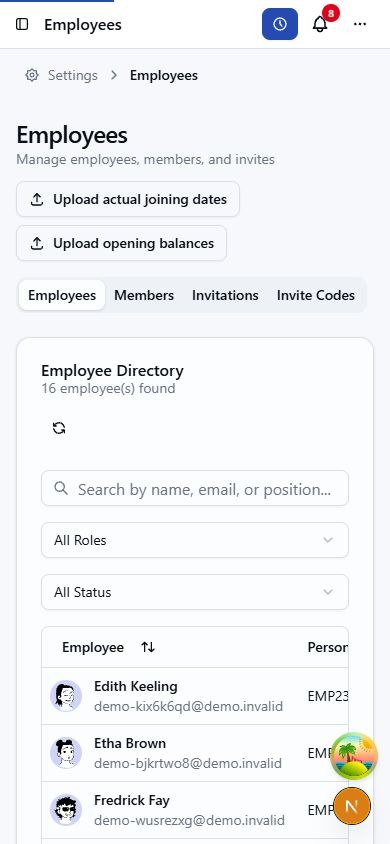

# Z8 mobile view audit

Status: partial. The full browser audit is not complete.

The confirmed mobile usability issues are the employee directory and time-entry history, which retain wide desktop tables on phone screens. The live route inventory contains 161 page patterns: 142 static routes and 19 dynamic routes. Chrome became unresponsive while opening Org Explorer, before the remaining routes could be reviewed.

## Scope and method

- Date: 16 October 2026. Local app: `https://z8.localhost/en`.
- Browser: connected Chrome. Viewport: 390 × 844 CSS pixels.
- Account: organization owner with platform-admin access. Demo employees, work periods and notifications were present.
- Review was read-only. No records, feature switches, authentication settings or integrations were changed.
- A 320 px follow-up, additional locales, keyboard/real-device checks, and modal/form states remain pending.
- Horizontal scrolling is reported as a usability issue when common row information or actions require moving across a desktop table. Intentional two-dimensional calendar/chart scrolling is not automatically a defect.

## Confirmed issues

| ID | Severity | Route | Mobile issue | Evidence | Suggested direction |
| --- | --- | --- | --- | --- | --- |
| M01 | Medium | `/settings/employees` | Employee directory requires extensive horizontal scrolling to reach the row actions. | At 390 px viewport width, the table is 1041 px wide inside a 306 px scrolling container. The populated state contains 16 employee rows. Team, role, contract, status and actions are off the initial screen. | Use employee cards at phone widths or keep the employee name and row action visible while allowing optional columns to scroll. |
| M02 | Medium | `/time-tracking` | Time-entry history keeps a desktop table at phone widths. | At 390 px viewport width, the history table is 639 px wide inside a 296 px scrolling container. Ten rows are populated. Reading both clock endpoints, duration and description requires horizontal scrolling. | Offer a stacked work-period row on mobile, with both endpoints and duration visible and details behind an explicit expansion. |

### Employee directory evidence

The table is intentionally contained by `overflow-x-auto`, so it does not widen the whole page. The issue is that the phone layout keeps all eight desktop columns and places the employee actions at the far edge.

Source locations:

- `apps/webapp/src/app/[locale]/(app)/settings/employees/employees-page-client.tsx:446`
- `apps/webapp/src/components/time-tracking/time-entries-table.tsx:141`

## Follow-up candidates from source inspection

These are candidates for browser verification, not confirmed mobile defects.

| Routes | Candidate | Source |
| --- | --- | --- |
| `/analytics`, `/analytics/work-hours`, `/analytics/vacation-trends`, `/analytics/team-performance`, `/analytics/overtime-burn-down` | Five equal-width navigation tabs share the phone-width row; check label clipping and reachability. | `apps/webapp/src/app/[locale]/(app)/analytics/layout.tsx:124` |
| `/settings/payroll-export` | Multi-provider tab bar has no route-level mobile wrapping or scrolling override. | `apps/webapp/src/app/[locale]/(app)/settings/payroll-export/page.tsx:148` |
| `/settings/export` | Export tabs use the default tab layout; check the longest labels at 320 px. | `apps/webapp/src/app/[locale]/(app)/settings/export/export-settings-view.tsx:59` |
| `/settings/employees/[employeeId]` | Detail tabs use the default tab layout; verify that all tabs stay reachable. | `apps/webapp/src/app/[locale]/(app)/settings/employees/[employeeId]/employee-detail-page-client.tsx:311` |
| `/team/absences` | The table has a 760 px minimum width; inspect its mobile alternative and access to actions. | `apps/webapp/src/app/[locale]/(app)/team/absences/team-absences-table.tsx:329` |
| `/team` | The table variant has a 760 px minimum width; verify the cards/table toggle and defaults. | `apps/webapp/src/app/[locale]/(app)/team/team-members-list.tsx:555` |

## Route coverage

Routes below omit the `/en` locale prefix. Dynamic routes require a real record discovered through the UI; token-based routes require a valid invitation, share link or setup context. Unreviewed routes are not passes.

| Route pattern | Browser coverage |
| --- | --- |
| `/` | Initial mobile dashboard reviewed before demo data refresh; populated repeat pending. |
| `/absences` | Visited, but only the loading shell was captured; not reviewed. |
| `/accept-invitation/[invitationId]` | Not reviewed; real record or valid token required. |
| `/analytics` | Not reviewed; Chrome connection unavailable. |
| `/analytics/overtime-burn-down` | Not reviewed; Chrome connection unavailable. |
| `/analytics/team-performance` | Not reviewed; Chrome connection unavailable. |
| `/analytics/vacation-trends` | Not reviewed; Chrome connection unavailable. |
| `/analytics/work-hours` | Not reviewed; Chrome connection unavailable. |
| `/approvals` | Not reviewed; Chrome connection unavailable. |
| `/approvals/deputy-decisions/[absenceId]` | Not reviewed; real record or valid token required. |
| `/approvals/inbox` | Not reviewed; Chrome connection unavailable. |
| `/approvals/review/[organizationId]/[kind]/[id]` | Not reviewed; real record or valid token required. |
| `/billing/suspended` | Not reviewed; Chrome connection unavailable. |
| `/calendar` | Day view reviewed; week, month, year and filter interactions pending. |
| `/calendar/[employeeId]` | Not reviewed; real record or valid token required. |
| `/compliance` | Not reviewed; Chrome connection unavailable. |
| `/forgot-password` | Not reviewed; Chrome connection unavailable. |
| `/init` | Not reviewed; Chrome connection unavailable. |
| `/join/[code]` | Not reviewed; real record or valid token required. |
| `/kiosk` | Not reviewed; Chrome connection unavailable. |
| `/licenses` | Not reviewed; Chrome connection unavailable. |
| `/my-documents` | Not reviewed; Chrome connection unavailable. |
| `/my-requests` | Initial populated request list reviewed; request details and filter interactions pending. |
| `/notifications` | Populated notification list measured. Header has 18 px internal overflow; screenshot verification pending. |
| `/onboarding/complete` | Not reviewed; Chrome connection unavailable. |
| `/onboarding/notifications` | Not reviewed; Chrome connection unavailable. |
| `/onboarding/organization` | Not reviewed; Chrome connection unavailable. |
| `/onboarding/profile` | Not reviewed; Chrome connection unavailable. |
| `/onboarding/vacation-policy` | Not reviewed; Chrome connection unavailable. |
| `/onboarding/welcome` | Not reviewed; Chrome connection unavailable. |
| `/onboarding/wellness` | Not reviewed; Chrome connection unavailable. |
| `/onboarding/work-schedule` | Not reviewed; Chrome connection unavailable. |
| `/onboarding/work-templates` | Not reviewed; Chrome connection unavailable. |
| `/organization` | Not reviewed; Chrome connection unavailable. |
| `/payroll` | Not reviewed; Chrome connection unavailable. |
| `/payroll/work-balances` | Not reviewed; Chrome connection unavailable. |
| `/payroll/work-balances/[employeeId]` | Not reviewed; real record or valid token required. |
| `/personnel-files` | Not reviewed; Chrome connection unavailable. |
| `/personnel-files/[employeeId]` | Not reviewed; real record or valid token required. |
| `/personnel-files/due-for-deletion` | Not reviewed; Chrome connection unavailable. |
| `/personnel-files/payslip-batches` | Not reviewed; Chrome connection unavailable. |
| `/personnel-files/payslip-batches/[batchId]` | Not reviewed; real record or valid token required. |
| `/personnel-files/sick-leave` | Not reviewed; Chrome connection unavailable. |
| `/platform-admin` | Not reviewed; Chrome connection unavailable. |
| `/platform-admin/analytics` | Not reviewed; Chrome connection unavailable. |
| `/platform-admin/billing` | Not reviewed; Chrome connection unavailable. |
| `/platform-admin/diagnostics` | Not reviewed; Chrome connection unavailable. |
| `/platform-admin/organizations` | Not reviewed; Chrome connection unavailable. |
| `/platform-admin/settings` | Not reviewed; Chrome connection unavailable. |
| `/platform-admin/system-email-templates` | Not reviewed; Chrome connection unavailable. |
| `/platform-admin/users` | Not reviewed; Chrome connection unavailable. |
| `/platform-admin/worker-queue` | Not reviewed; Chrome connection unavailable. |
| `/reports` | Not reviewed; Chrome connection unavailable. |
| `/reports/projects` | Not reviewed; Chrome connection unavailable. |
| `/reports/vehicles` | Not reviewed; Chrome connection unavailable. |
| `/reset-password` | Not reviewed; Chrome connection unavailable. |
| `/scheduling` | Not reviewed; Chrome connection unavailable. |
| `/settings` | Not reviewed; Chrome connection unavailable. |
| `/settings/approval-escalation` | Not reviewed; Chrome connection unavailable. |
| `/settings/approval-policies` | Not reviewed; Chrome connection unavailable. |
| `/settings/audit-export` | Not reviewed; Chrome connection unavailable. |
| `/settings/audit-log` | Not reviewed; Chrome connection unavailable. |
| `/settings/avv` | Not reviewed; Chrome connection unavailable. |
| `/settings/billable-time` | Not reviewed; Chrome connection unavailable. |
| `/settings/billable-time/accounting` | Not reviewed; Chrome connection unavailable. |
| `/settings/billable-time/cost-rates` | Not reviewed; Chrome connection unavailable. |
| `/settings/billable-time/hand-off` | Not reviewed; Chrome connection unavailable. |
| `/settings/billable-time/rates` | Not reviewed; Chrome connection unavailable. |
| `/settings/billing` | Not reviewed; Chrome connection unavailable. |
| `/settings/calendar` | Not reviewed; Chrome connection unavailable. |
| `/settings/change-policies` | Not reviewed; Chrome connection unavailable. |
| `/settings/clocking` | Not reviewed; Chrome connection unavailable. |
| `/settings/clockodo-import` | Not reviewed; Chrome connection unavailable. |
| `/settings/closed-months` | Not reviewed; Chrome connection unavailable. |
| `/settings/compliance` | Not reviewed; Chrome connection unavailable. |
| `/settings/compliance/works-council` | Not reviewed; Chrome connection unavailable. |
| `/settings/coverage-rules` | Not reviewed; Chrome connection unavailable. |
| `/settings/custom-fields` | Not reviewed; Chrome connection unavailable. |
| `/settings/customers` | Not reviewed; Chrome connection unavailable. |
| `/settings/demo` | Not reviewed; Chrome connection unavailable. |
| `/settings/discord` | Not reviewed; Chrome connection unavailable. |
| `/settings/email-templates` | Not reviewed; Chrome connection unavailable. |
| `/settings/employees` | Confirmed M01; populated directory reviewed. Other tabs and dialogs pending. |
| `/settings/employees/[employeeId]` | Not reviewed; real record or valid token required. |
| `/settings/employees/new` | Not reviewed; Chrome connection unavailable. |
| `/settings/enterprise` | Not reviewed; Chrome connection unavailable. |
| `/settings/enterprise/api-keys` | Not reviewed; Chrome connection unavailable. |
| `/settings/enterprise/api-keys/[keyId]` | Not reviewed; real record or valid token required. |
| `/settings/enterprise/audit-log` | Not reviewed; Chrome connection unavailable. |
| `/settings/enterprise/branding` | Not reviewed; Chrome connection unavailable. |
| `/settings/enterprise/domains` | Not reviewed; Chrome connection unavailable. |
| `/settings/enterprise/email` | Not reviewed; Chrome connection unavailable. |
| `/settings/enterprise/identity-setup` | Not reviewed; Chrome connection unavailable. |
| `/settings/enterprise/sso` | Not reviewed; Chrome connection unavailable. |
| `/settings/export` | Not reviewed; Chrome connection unavailable. |
| `/settings/export-operations` | Not reviewed; Chrome connection unavailable. |
| `/settings/export/history/[organizationId]` | Not reviewed; real record or valid token required. |
| `/settings/holidays` | Not reviewed; Chrome connection unavailable. |
| `/settings/implementation-checklist` | Not reviewed; Chrome connection unavailable. |
| `/settings/import` | Not reviewed; Chrome connection unavailable. |
| `/settings/import/[batchId]` | Not reviewed; real record or valid token required. |
| `/settings/kiosks` | Not reviewed; Chrome connection unavailable. |
| `/settings/locations` | Not reviewed; Chrome connection unavailable. |
| `/settings/locations/[locationId]` | Not reviewed; real record or valid token required. |
| `/settings/my-data` | Not reviewed; Chrome connection unavailable. |
| `/settings/notification-channels` | Not reviewed; Chrome connection unavailable. |
| `/settings/notifications` | Not reviewed; Chrome connection unavailable. |
| `/settings/organizations` | Not reviewed; Chrome connection unavailable. |
| `/settings/payroll-access` | Not reviewed; Chrome connection unavailable. |
| `/settings/payroll-export` | Not reviewed; Chrome connection unavailable. |
| `/settings/payroll-readiness` | Not reviewed; Chrome connection unavailable. |
| `/settings/permissions` | Not reviewed; Chrome connection unavailable. |
| `/settings/personnel-files` | Not reviewed; Chrome connection unavailable. |
| `/settings/position-capture` | Not reviewed; Chrome connection unavailable. |
| `/settings/position-stamps` | Not reviewed; Chrome connection unavailable. |
| `/settings/profile` | Not reviewed; Chrome connection unavailable. |
| `/settings/projects` | Not reviewed; Chrome connection unavailable. |
| `/settings/report-share-links` | Not reviewed; Chrome connection unavailable. |
| `/settings/roles` | Not reviewed; Chrome connection unavailable. |
| `/settings/scheduled-exports` | Not reviewed; Chrome connection unavailable. |
| `/settings/security` | Not reviewed; Chrome connection unavailable. |
| `/settings/shifts` | Not reviewed; Chrome connection unavailable. |
| `/settings/skills` | Not reviewed; Chrome connection unavailable. |
| `/settings/slack` | Not reviewed; Chrome connection unavailable. |
| `/settings/statistics` | Not reviewed; Chrome connection unavailable. |
| `/settings/surcharges` | Not reviewed; Chrome connection unavailable. |
| `/settings/teams` | Not reviewed; Chrome connection unavailable. |
| `/settings/teams-notifications` | Not reviewed; Chrome connection unavailable. |
| `/settings/teams/[teamId]` | Not reviewed; real record or valid token required. |
| `/settings/telegram` | Not reviewed; Chrome connection unavailable. |
| `/settings/travel-expenses` | Not reviewed; Chrome connection unavailable. |
| `/settings/vacation` | Not reviewed; Chrome connection unavailable. |
| `/settings/vacation/employees` | Not reviewed; Chrome connection unavailable. |
| `/settings/vacation/employees/[employeeId]` | Not reviewed; real record or valid token required. |
| `/settings/vehicle-use` | Not reviewed; Chrome connection unavailable. |
| `/settings/vehicles` | Not reviewed; Chrome connection unavailable. |
| `/settings/webhooks` | Not reviewed; Chrome connection unavailable. |
| `/settings/wellness` | Not reviewed; Chrome connection unavailable. |
| `/settings/work-categories` | Not reviewed; Chrome connection unavailable. |
| `/settings/work-diagnostics` | Not reviewed; Chrome connection unavailable. |
| `/settings/work-policies` | Not reviewed; Chrome connection unavailable. |
| `/setup` | Not reviewed; Chrome connection unavailable. |
| `/share/[token]` | Not reviewed; real record or valid token required. |
| `/sign-in` | Not reviewed; Chrome connection unavailable. |
| `/sign-up` | Not reviewed; Chrome connection unavailable. |
| `/team` | Not reviewed; Chrome connection unavailable. |
| `/team/absences` | Not reviewed; Chrome connection unavailable. |
| `/team/driving` | Not reviewed; Chrome connection unavailable. |
| `/team/period-submissions` | Not reviewed; Chrome connection unavailable. |
| `/team/presence` | Not reviewed; Chrome connection unavailable. |
| `/team/presence/[locationId]` | Not reviewed; real record or valid token required. |
| `/time-tracking` | Confirmed M02; populated timeline and history measured. Entry dialogs pending. |
| `/today` | Not reviewed; Chrome connection unavailable. |
| `/travel-expenses` | Initial empty receipt/trip list reviewed; creation panels and populated states pending. |
| `/travel-expenses/[claimId]` | Not reviewed; real record or valid token required. |
| `/travel-expenses/finance` | Initial finance view reviewed; no populated expense report opened. |
| `/travel-expenses/reports/[reportId]` | Not reviewed; real record or valid token required. |
| `/verify-2fa` | Not reviewed; Chrome connection unavailable. |
| `/verify-email` | Not reviewed; Chrome connection unavailable. |
| `/verify-email-pending` | Not reviewed; Chrome connection unavailable. |
| `/works-council` | Not reviewed; Chrome connection unavailable. |

## Evidence and resumption

- Ticket: [#1273](https://github.com/Umami-Creative-GmbH/z8/issues/1273).
- Live source checkout: `X:/Projects/umami/z8`; report checkout: `Y:/Codex/Worktrees/faa6/z8`. Source line numbers refer to the live checkout inspected on the audit date.
- Measurements are saved in `mobile-2026-10-16-measurements.json`. Raw browser observations and screenshots are in the chat artifact directory `mobile-audit-1273`.
- Resume by restoring Chrome, revisiting the loading/partial states, then completing every unreviewed route and real-record detail view. Reset the temporary viewport override when finished.
